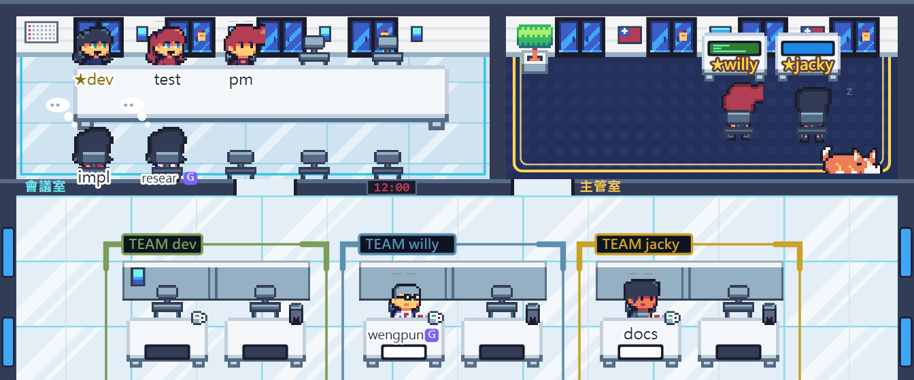

# pixel-office

**English** | **[繁體中文](README.zh-TW.md)**

A Claude Code plugin that turns every running Claude Code session into a pixel-art coworker in a shared office, plus a way to run many sessions as a team.
**Claude and Google Antigravity can sit in the same office and hand work to each other.**


<sub>Claude Desktop view. ★ marks a manager: ★willy and ★jacky are top-level managers in the manager's room; ★dev is a **layer-2 department lead**, so it sits at the first desk of its own "TEAM dev" area with its squad. research and wengpun are Antigravity (G).</sub>

- **See what everyone is doing**: typing, reading, thinking, erroring, waiting for your approval — at a glance
- **Multi-session teamwork**: one skill, `team` — managers and staff, task hand-off, meetings
- **Cross-vendor AI teamwork**: Antigravity CLI (agy) conversations join the office with a blue-violet **G** badge and message Claude sessions
- **Manage it from anywhere**: with Cloudflare, watch the office and send a command to any session from your phone

## ✨ Claude × Antigravity, working together

Each AI runs in its own window, and they assign work to each other in the same office:

```
Claude (manager) ── mail: "look up specs for these three parts" ──▶ agy (research)
Claude (manager) ◀── reply: a tidy spec table ───────────────────── agy
```

- **Play to each side's strengths, separate quotas**: when Claude's quota runs low, hand lookups and tidy-up work to agy's Gemini
- **agy waits for the reply on its own** (up to 90 s) and continues when it arrives — no copy-pasting between windows
- **agy has its own office tools**: set a nameplate, see who's online, send mail — the same set Claude uses
- **Both sides use normal interactive windows**, not `-p`, so you can always watch and step in
- Safeguards: mail is labeled "from another AI, not the user"; AI-to-AI auto replies stop after 5 rounds

One-time setup: [docs/agy-寄件協作.md](docs/agy-寄件協作.md) (Chinese)

> Moved out of [llm-wiki-plugin](https://github.com/Q00jkf/llm-wiki-plugin) on 2026-10-29, with full history.
> ⚠️ Built on Claude Code function hooks (early access; may change between versions).

## 📱 Manage it from anywhere (Cloudflare remote)

A small local server draws the same office; connect it through Cloudflare Tunnel and open it in your phone's browser (add it to your home screen):

- **Watch**: who is doing what, who is stuck, who is waiting for you
- **Tap a coworker**: title, status, latest error, and its last reply
- **Send a command**: type on the card and that session runs it as if you typed it (marked 📱)
- **Only you get in**: Cloudflare Access in front lets only your login through; the server itself listens on localhost only
- No session needs its panel open — just keep the computer on. Permission approvals still happen on the computer

Setup: the "手機版" (mobile) section of [docs/使用說明.md](docs/使用說明.md)

## Install

```
/plugin marketplace add Q00jkf/pixel-office
/plugin install pixel-office@pixel-office
```

Restart Claude Code and type `/office`.

Previously installed `pixel-office@llm-wiki`? Run `/plugin uninstall pixel-office@llm-wiki` first, then install as above. Nameplates and buttons are kept.

## Everyday commands

| Command | What it does |
|---|---|
| `/office` | Open the office panel |
| `/office who` | Who's online and what they're doing |
| `/office name <letters/digits>` | Set your desk nameplate |
| `/office title <title>` | Set your job title |
| `/office role manager` / `staff` | Switch role (managers sit in the manager's room) |

Click furniture for a menu (mail, git, start/end of day…); click the pet to feed it.

## Teamwork (skill `team`)

How one person splits work across many sessions. It is a single skill — no commands to learn, just tell Claude.

### Two layers

| Layer | When | In the office |
|---|---|---|
| 0 | One session does it all | A staff desk |
| 1 | One manager leads a few staff | Manager in the manager's room, staff in the "TEAM <manager>" area |
| 2 | The project needs departments | A **department lead** (★dev above) takes the first desk of its own area and leads its own squad; the top manager stays in the manager's room |

- Step up: say "you're the manager", or a session proposes it — **it only happens when you agree**
- Step down: after 20 minutes with nobody online under a manager, it reminds you and asks; it never steps down by itself

### Multiple managers

Run several projects at once, each with its own manager: the manager's room holds up to 3 desks, and each manager's staff sit in their own area with a different carpet colour, so you can tell the teams apart instantly.

### Role design

- **No built-in methodology**: say "set up roles following <rules>" (AIMM, gstack, your own process); it lists roles and boundaries, and creates them only after you approve
- **Role cards** live in the project's `.claude/office/roles/` by default (committed to git; another folder can be set per project in `~/.claude/office/projects.json`): responsibilities, boundaries, deliverables; progress goes into checkpoints, so a new session can pick up where the last one left off
- **Squads**: save a set of roles you use often (e.g. "dev + test", "PM + purchasing") in `~/.claude/office/squads/`, shared across the machine; pick one when opening layer 2

### Meetings

Say "let's have a meeting" to have several sessions work out a plan together; invited coworkers walk into the meeting room and return to their desks when it ends.



<sub>The 5 invitees (including department lead ★dev and Antigravity's research) sit in the meeting room and the TEAM dev desks are empty; everyone else keeps working at their desk.</sub>

## More

The in-app text is English; the detailed docs are in Traditional Chinese.

- All commands, personal buttons, click-to-approve, mobile, rendering details: [docs/使用說明.md](docs/使用說明.md)
- Antigravity CLI: [docs/agy-寄件協作.md](docs/agy-寄件協作.md)
- Hacking on it: [CLAUDE.md](CLAUDE.md)
