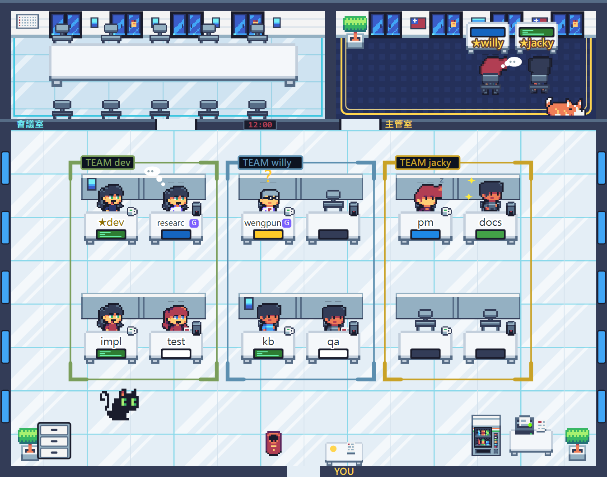

# pixel-office（像素辦公室）

把同時開著的每個 Claude Code session 畫成辦公室裡的一位同事。



llm-wiki marketplace 裡的 plugin：只要畫面可以不裝；**要多 session 協作就要裝**——協作做法（skill `team`）在這裡，llm-wiki 的 `wiki-collabteam` 只補 vault 專屬規則。

> ⚠️ 使用 Claude Code 的 function hooks（early access，版本間可能變動）。2026-10-03 於 Claude Code 2.1.288 開發與測試。

## 安裝

```
/plugin marketplace add Q00jkf/llm-wiki-plugin
/plugin install pixel-office@llm-wiki
```

重開 Claude Code 後輸入 `/office` 開面板。

## 用法

| 指令／按鈕 | 作用 |
|---|---|
| `/office` | 開辦公室面板 |
| `/office role 主管` ／ `/office role 員工` | 設定這個 session 的角色；角色變了人會走進／走出主管室 |
| `/office name <英數字>` | 桌上名牌（1～12 字，中文在像素畫寬兩格放不下） |
| `/office title <職稱>` | 職稱（最多 16 字，可中文；不畫在圖上，名單裡看得到） |
| `/office who` | 列出在線每人的名牌、職稱、角色、ListAgents 名稱、目前狀態（見下方「名單」） |
| `/office agent <名稱>` | 登記 ListAgents 名稱，別人傳訊息給你時才畫得出紙飛機 |
| `/office buttons` | 重讀個人按鈕設定（`~/.claude/pixel-office/buttons.json`，見下方「個人按鈕」） |
| `/office team <主管名稱>｜off` | 登記你歸哪位主管（填主管的 ListAgents 名稱）；peer 坐最右邊那一區，其他人坐左邊。主管也可以填，填了就是**部門主管**（見「協作」） |
| `/office auto on｜off` | 宣告這個 session 是 auto 權限模式；auto 的權限詢問交給分類器，不舉手 |
| `/office approve on｜off` | 這個視窗開著面板時，要不要替別的 session 按權限核准（見下方「點人核准」）；**預設關**，重開後記得 |
| `/office bite [名牌]` | 放貓咬人（小寶寶是爬過去抱大腿、山雀是飛過去唱歌）；不指定就隨機挑一位員工，主管在主管室不會被咬 |
| `/office pet [cat｜baby｜bird]` | 辦公室裡的貓、小寶寶、銀喉長尾山雀切換（不帶參數就依序換）；只影響自己看到的畫面，重開後仍記得 |
| `/office meeting [off]` | 看目前的會議（題目、參與者）；`off` 提早散會 |
| 夜間模式 | Desktop：點牆上任何一扇窗切換；終端機：面板按鈕「夜間模式」(`n`)，快捷鍵要先點面板或 ctrl+x tab 讓面板取得焦點 |
| **點寵物** | 走動中：貓餵飯、寶寶餵奶、山雀放飛（飛去找人唱歌）；停著（正在吃、坐著）再點一下 → 換下一隻（貓 → 寶寶 → 山雀 → 貓）；出去咬人時點了只回「還在外面」。結果在 Desktop 跳提示；終端機另在按鈕列右邊留一行約 5 秒 |
| **點柯基**（只在 Desktop） | 冒愛心 |
| **點家具** | 旁邊展開小選單，選一項就把 prompt 送進這個視窗（見下方「家具選單」）；再點同一件或按「取消」收起，同時只開一個 |

模型也能自己設定：工具 `mcp__pixel-office__office_profile`，系統提示會提醒它「被指派或卸下主管時呼叫」。

## 協作（skill `team`，0.25.0 起）

一人開多個 session 時怎麼分工。外掛只當**輔助**（畫面、省 token），**不內建任何方法**：要照 AIMM、gstack 或專案自己的流程，說「照 <規則> 設角色」，它讀完列出角色與邊界，你核可才建卡（jacky 2026-10-29 定）。

| 層 | 長相 | 辦公室 |
|---|---|---|
| 0 | 一個 session 自己做完 | 員工 |
| 1 | 主管帶幾條線 | 主管坐主管室，peer 掛 `team` |
| 2 | 專案主管底下分部門 | 部門主管＝`role=主管`＋`team=<專案主管>`，**坐自己部門那一區第一個位子**、那一區的地毯和「TEAM」是他的；名單標「部門主管」。上一層主管不在線時照舊當主管；互相掛不算 |

- **升層**：session 提議、你說好才登記成主管；這時才建專案資料夾 `<主 repo>/.claude/office/`（worktree 一律寫回主 repo）：`collab.md`（狀態，只有主管寫）、`roles/<角色>.md`（定義，進 git）、`checkpoints/<角色>.md`（只往後加）；資料夾裡自帶 `.gitignore` 讓前一個和最後一個不進 git。外掛本身不寫專案檔，由 skill 建
- **降層**：主管底下沒有在線的人滿 20 分鐘，外掛在你下一則指令附一句提醒給模型（一段沒人的期間只提醒一次），它會問你要不要降；**不自動改**
- 細節在 `skills/team/`：`SKILL.md`（入口）、`roles.md`（產生角色、角色卡、接手、檢查點）、`lead.md`（升降層、collab.md、派工、回報）、`meet.md`（開會）

## 名單（`/office who`、工具 `office_roster`）

- **目前**：「🟡 等核准 N 秒（工具）」與「等輸入（N 分）」分開；出錯時附錯誤第一行（最多 80 字），之後 10 分鐘內在狀態後面標「上次出錯 N 分前」
- **職稱**：沒設時，收到使用者指令就用 session 標題（有的話）或指令前 16 字自動帶，標「(自動)」；自動帶的放超過 30 分鐘再來新指令才換。模型或 `/office title` 手動設的永遠不自動蓋，但超過 30 分鐘沒更新又來新指令時標「（N 分前設）」，「目前」欄附最新指令，讓主管看出職稱跟實際工作對不上
- **ListAgents 名稱**：沒登記名稱的人，若這版 Claude Code 有 `CLAUDE_CODE_MESSAGING_SOCKET`，改顯示「SendMessage 用 to=uds:…」，照填就送得到
- **一次性對話**（`claude -p`、SDK：`session.start` 的 `isInteractive`＝false）：不列進名單、不畫成員工，名單最後一行計數；畫面上在走廊櫃台右邊（窄面板在檔案櫃右上）放徽章「⚙ <前綴> ×N」，前綴是 `--name` 第一個 `-` 之前（`API-標籤正本-02-3` → `API`），沒帶 `--name` 的歸「一次性」。終端機改在按鈕列右邊留一行
- **名牌與 `--name`**：互動 session 用 `claude --name X` 開的，預設名牌是 X（去掉非 ASCII、截 12 字，剩不到 2 字就照舊用資料夾名）；手動設過的名牌不受影響

## 家具選單

點辦公室裡的家具會在旁邊展開選單，沒有快捷鍵。預設：

| 家具 | `object` | 選單 |
|---|---|---|
| 影印機（信件） | `printer` | 查最近信件、寫信、看草稿 |
| 檔案櫃（外部資料） | `cabinet` | 列出掛載的來源、查知識庫、搜 Google Drive |
| 郵筒（git） | `mailbox` | 狀態、pull、push、最近 commit |
| 牆上月曆 | `calendar` | 看日程、加日程 |
| 販賣機 | `vending` | 健康檢查、知識庫現況 |
| 時鐘 | `clock` | 開工、收工 |
| 會議桌 | `meeting` | 開會 |

- 送出的 prompt 全文在 `hooks/register.tsx` 的 `MENUS`；寄信、push 類的 prompt 都要求「先給我確認」
- 想換掉某件家具的選單：在 `buttons.json` 寫帶 `object` 的項目（見下節），**那件家具整份換成你的**，其他家具照預設；每件最多 6 項
- 選單開在家具的右、左、上、下其中一側：整個要留在家具所在的房間（會議室的選單不會壓到主管室），優先挑不蓋到其他可點的東西與櫃台的那一側。**只看固定的擺設、不看走動的人與寵物**：同一個版面下，每件家具的選單永遠開在同一個位置（會蓋到剛好走過的人）
- Desktop 的選單是深色底、金色圓角框，第一列是家具名
- 畫面上沒畫出來的家具沒有選單（例如 48 欄時時鐘放不下、櫃台旁擠不下販賣機）。終端機沒畫柯基、販賣機，月曆與時鐘也不在同一個位置，這四樣只在 Desktop 點得到
- 怎麼點得到：在場景上疊透明按鈕（absolute `Box`）。換算：終端機一格＝1 單位寬、2 單位高；Desktop 一欄＝1 單位、一列＝**2.5 單位**（2026-10-27 Desktop 實測，`office-calib` 0.0.2 四個十字都對準；常數 `CELL_UNITS`）。面板窄於 48 欄、Svg 被縮小時照「面板欄數／場景寬」等比換算。Desktop 用整塊空白的 plain 按鈕蓋住家具（看不見）；終端機每件家具中心一個淡色 `▾`、寵物 `♥`（Raster 上的按鈕會蓋掉底下那一格，鋪滿會把家具擦掉）

## 個人按鈕（不進 repo）

在自己電腦建 `~/.claude/pixel-office/buttons.json`。沒有 `object` 的項目（最多 6 顆）：終端機出現在辦公室與下方按鈕列之間那一列；Desktop 疊在員工區上緣左邊，不另外佔白底；有 `object` 的項目換掉那件家具的選單（見上節）。
最快的做法是複製 plugin 附的範例檔再改：

```
cp "<plugin 目錄>/plugins/pixel-office/buttons.example.json" ~/.claude/pixel-office/buttons.json
```

內容長這樣：

```json
[
  { "object": "printer", "label": "查信", "prompt": "用 Gmail 查我最近的未讀信件並摘要" },
  { "object": "printer", "label": "寫信", "prompt": "幫我寫一封信：先問我收件人與內容，寄出前給我確認" },
  { "label": "開工", "prompt": "/llm-wiki:wiki-day 開工" },
  { "label": "文件", "url": "https://example.com" }
]
```

- `prompt`：送給**按下按鈕的那個視窗**，等同你親自輸入；`/` 開頭當 slash 指令執行。照常受權限管控。
- `url`：用瀏覽器開，只收 `http`／`https`（家具選單項目不收 `url`）。
- `object`：`printer`／`cabinet`／`mailbox`／`calendar`／`vending`／`clock`／`meeting` 之一；寫錯的項目略過。
- `label` 1～12 字。改完檔案約 10 秒內自動生效（也可輸入 `/office buttons` 立刻重讀）。沒有這個檔就不顯示。

## 畫面

俯視平面圖：上排會議室＋主管室，下方員工區（四人一組、十字隔板），底部走廊有貓、檔案櫃、影印機、販賣機。

- 每個 session 的狀態即時反映在小人與螢幕：打字、讀檔、思考、出錯、完成
- 主管坐主管室：一位坐 L 型大桌；兩位以上換小桌，面板夠寬最多 3 張（80 欄以上 3 張、60 欄以上 2 張、更窄 1 張），坐不下的主管不畫，最後一張桌的名牌前面加 `+N`
- 登記為某位主管 peer 的人（`/office team`）坐那位主管的區：第一位主管最右一欄、第二位往左一欄…，各鋪一種地毯（金、藍、綠）、上方掛「TEAM <主管名牌>」；有人分不到區（沒有 team，或他的主管排不進分區）時，最左一欄留給他們，沒有就每欄都能當分區。一位主管時有沒有 peer 都鋪；兩位以上只給有 peer 在線的主管，坐不下桌子的主管也有分區。排得出兩欄才分區；換區時會起身走過去
- 大門右邊是使用者的櫃台（下方外牆標 `YOU`），等核准的人拿紙來這裡排隊（見「點人核准」）；面板太窄（約 58 欄以下）放不下就不畫，改排大門口
- 每人有固定座位，別人進出不會讓他換位
- **開會**：開會（說「開會」，skill `team` 的 `meet.md`）時呼叫工具 `office_meeting`，被點名的參與者（不限 team）閒著就走進會議室坐下，忙的做完再進，散會才走回原座位；不設期限，主持人散會（`action=end`）或參與者全都離線就清空；只是畫面，討論本身由 skill `team` 的 `meet.md` 跑。`/office meeting` 看狀態、`/office meeting off` 提早散會。底層是 `~/.claude/pixel-office/meeting.json` = `{"until": <epoch ms>, "topic": "…", "participants": ["<ListAgents 名稱或名牌>"]}`；沒有 `participants` 時改由主管的 peer 進場
- **對外動作會跑腿**：寄信（Gmail 寄送／回覆／轉寄／草稿）拿著紙走去影印機；上傳文件（Google Drive、Notion 建立／更新）拿資料夾走去檔案櫃；`git push` 拿包裹走去大門口的郵筒；成功才算，走完回座位
- 員工座位坐不下時左上角顯示 `+N`
- 終端版用色塊（`▀`）即時畫、每秒 4 格；Claude Desktop 畫 SVG（`hooks/vector.ts`）：人、家具、黑貓、柯基用 2dPig 素材圖（白牆窗戶、藍磚地板、隔間桌；5 個人物依名字固定分配，再依名字換上衣顏色，主管穿深藍西裝），寶寶與山雀是同色盤手繪的像素圖（坐／爬、停／飛兩格）；檔案櫃素材沒有，照色盤畫；名牌、狀態泡泡（思考、出錯冒汗、等核准問號、紅牌、打瞌睡 z）、螢幕、團隊地毯用向量畫；走路左右腳交替（兩格跨步＋1 像素起伏，往左走翻面、上下走維持正面），打字上下輕跳；名牌與門牌可以是中文；員工區牆上時鐘顯示現在時間（本機時區），每 0.5 秒更新一次（約每秒 2 格），按鈕相同。兩邊座位、走路、貓、紙飛機用同一套計算

面板最少要 46 列高（場景 44 列＋預留 1 列＋按鈕 1 列）（上排房間＋一排座位群＋走廊），寬 56 欄以上員工區排兩欄。

## 點人核准

**預設關閉。** 在要負責審核的那個視窗打 `/office approve on` 才會啟用（存起來，重開後仍記得）；開啟時面板頂端常駐一行「核准已開啟（/office approve off 關閉）」。關著時面板不顯示「審」與 Allow／Deny，等核准的人照樣走去櫃台排隊、名單照樣標「等核准」—— 那是看 waiting 狀態，不靠單。

- 某個 session 要問「可以跑這個嗎」時，只要**有任何視窗開著辦公室面板且核准開啟**，就把單寫到 `~/.claude/pixel-office/approvals/<session>.json`；名單標「辦公室面板可審」。終端機原本的詢問照常出現，誰先按算誰的
- 🔴 **只有約 8 秒能按**：引擎給權限 hook 的預算固定 10 秒，超過就改由終端機問；所以單上帶截止時間（預算剩下的減 1.5 秒），過了就收單、交回終端機。面板與 `/office who` 第一行都顯示「剩 N 秒」
- 面板最上方出現「🟡 等你核准：審 <名牌>」→ 按下去看完整指令 → Allow／Deny／收起。Allow 展開後 1 秒才按得下去，單換成新的一筆就重新計算；指令超過 1500 字或 20 行只給 Deny，Allow 請回它的終端機按。沒有「永遠允許」，Allow／Deny 也沒有快捷鍵
- 決定寫到 `decisions/<session>.json`，等的那方比對 session、這次呼叫的 id、單上的隨機 nonce、**自己手上指令全文的 SHA-256** 四項全對才採用；不符就丟棄並記一行 log
- 不接手、直接交給終端機的情況：auto 等不問人的模式、subagent、沒有人開著面板且核准開啟、對不上是哪一次呼叫、檔案壞掉、截止前沒人按、預算剩不到約 3.5 秒、使用者中斷或終端機先按了。處理完兩個檔覆寫成 `{"state":"done"}`（不留指令內容）
- 🔴 **限制**：這兩個檔是本機共用檔，同一個使用者帳號下的其他程式（包括別的 Claude session 跑的 Bash）理論上讀得到 nonce、也寫得出決定。這個機制防的是**誤按與配錯**（看錯單、按到別人的、按到舊的、單被換字），**不防本機惡意程式**

## 手機版（第 3 期，0.20.0 起：只看）

`remote/server.ts` 是獨立的本機伺服器（bun），讀同一個共用資料夾、用 `scene.ts`／`vector.ts` 畫同一間辦公室，手機瀏覽器或「加到主畫面」打開。不靠任何 session 開著面板。

- 設定 `~/.claude/pixel-office/remote.json`（不進 repo）：`{ "port": 8767, "owner": "<Cloudflare Access 登入的 email>" }`
- 啟動：`bun <plugin>/remote/server.ts`，只聽 `127.0.0.1`
- 對外：Cloudflare Tunnel 加一個 public hostname 指到 `http://localhost:8767`，前面掛 Cloudflare Access（只允許 owner）。經 Cloudflare 進來的要求沒有 Access 驗過的 owner email 一律 403；本機直連放行
- 點人（0.21.0）：點圖上的人跳出卡片，看職稱、狀態、工具、隊伍、最近錯誤；還不能核准
- 下命令（0.22.0）：卡片下方輸入框送出 → 伺服器寫 `commands/<session>.json` → 那個 session 的外掛每秒來拿，當成使用者打的字送進對話（前面 📱）。對方要裝 0.22.0 以上；10 分鐘沒被收就作廢；回覆不傳回手機
- 最新回覆（0.23.0）：每個 session 每輪結束把最後的回覆寫到 `replies/<session>.json`（上限 8000 字），卡片顯示；回手機命令的那輪會標「回你：📱 …」。Markdown 照原文顯示
- 團隊分區：手機只有 2 欄，一隊佔一整排（8 個位子）、由上往下，沒 team 的人坐下面；排不下就把畫面加長，頁面上下滑
- 主畫面圖示：`remote/build_icon.py` 從素材表拼出 `icon-192.png`／`icon-512.png`／`icon-maskable.png`（Android 不吃 SVG 圖示），改圖就重跑
- 測試：`bun test plugins/pixel-office/remote`（檔名 `.spec.ts`：`claude plugin test` 會載入所有 `.test.ts`）

### 圖素：2dPig Pixel Office（CC0）

Desktop 畫面的人物、家具、黑貓、柯基來自 [2dPig「Pixel Office」](https://2dpig.itch.io/pixel-office)（CC0，原檔與授權在 `assets/2dpig/`）。
`assets/build_sheet.py` 從原素材表去掉天空、加上換色人物，產生 `assets/office-sheet.png` 與 `hooks/sheet.ts`（base64＋裁切框）；改素材或換色就重跑，兩個產物都進 repo。SVG 裡素材表只嵌一次，每個圖素是巢狀 `<svg viewBox>` 以 `<use>` 裁切引用。

## 運作方式

每個 session 每 5 秒把自己的狀態寫到 `~/.claude/pixel-office/sessions/<session-id>.json`（一個 session 一個檔，不互相覆蓋），每秒讀一次所有人的。超過 20 秒沒心跳或標記離開的不畫。只讀寫 `~/.claude/pixel-office/` 底下（sessions、approvals、decisions、commands、replies、meeting.json、buttons.json），不碰其他檔案、不連網。

## 開發

```
claude plugin validate plugins/pixel-office
claude plugin test plugins/pixel-office
```
